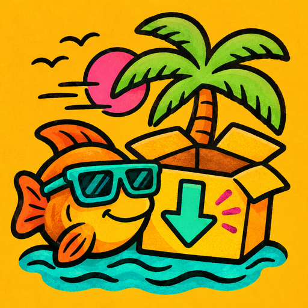

  

# Moztopia Releases

Public release assets from across Moztopia projects, in one place.

This repository is the shared download hub for Moztopia's public-facing releases. Browse the available releases here, or explore the projects and their downloads on the [Moztopia website](https://moztopia.com/projects).

**[Explore projects](https://moztopia.com/projects)** · **[Browse releases](https://github.com/moztopia/releases/releases)** · **[Read the wiki](https://github.com/moztopia/releases/wiki)**

## Find your download

1. Visit [Moztopia Projects](https://moztopia.com/projects) to find a product, learn what it does, and access its downloads.
2. For direct access, open this repository's [Releases](https://github.com/moztopia/releases/releases) and choose the release for your project.
3. Read the release notes, then expand **Assets** and download the file for your platform or intended use.

Check the release notes and project page for version details, compatibility, installation or usage instructions, and known limitations. Use each asset according to the license or terms supplied by its project.

## Need a hand?

See the wiki's [download guide](https://github.com/moztopia/releases/wiki/Downloading-Releases). For product help, start with the relevant project at [moztopia.com/projects](https://moztopia.com/projects).

If a download link or asset in this hub is broken, [open an issue](https://github.com/moztopia/releases/issues) with the project, release, filename, and a short description of the problem. Keep reports suitable for a public audience.

---

by-dolly
